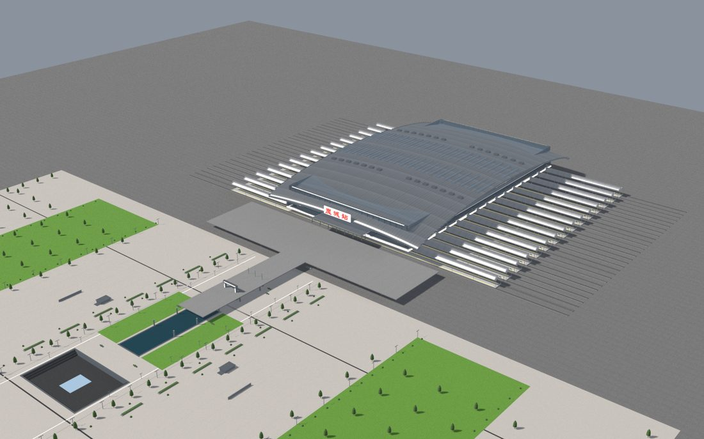
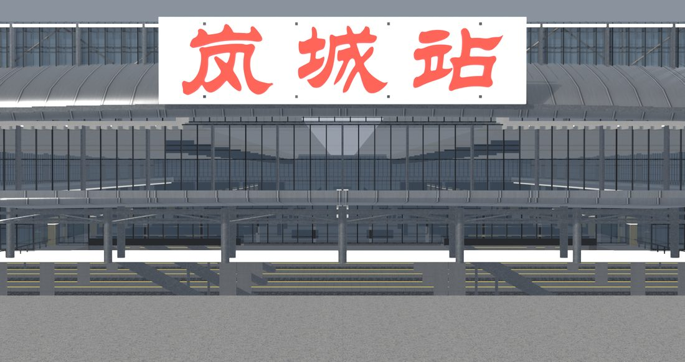

# 岚城站 · Lancheng Station 3D

原创虚构车站「岚城站」(CS1 枢纽) 的 **Blender 参数化建模 + 实时 3D 网页预览**。

**在线体验**：本仓库 Pages 即交互式 3D 预览——单文件 HTML，模型已内嵌，打开就能拖拽旋转 / 缩放，查看站厅、站台、出入口全貌。

## 这个项目做了什么

1. **资产方案设计**（CS1 枢纽资产方案 → 精修建模 v4）：站体分层结构、进出站动线、标识系统先画方案再动手
2. **Blender 参数化建模**：用 Python 脚本按规则生成站体几何——大跨站厅、岛式站台、出入口雨棚、"岚城站"中文站名标识，改参数即可调整比例
3. **渲染出图**：白模检查 → 材质灯光 → 透视 / 立面 / 夜景 / 站台 / 鸟瞰成片（见 `renders/`）
4. **导出与分发**：glTF (.glb) 导出，打包成**模型内嵌的单文件预览页**——发给别人不用带附件，一个 HTML 就是完整展厅

## 文件结构

```
├── index.html    # 交互式 3D 预览（模型内嵌，约 20MB，打开即用）
└── renders/      # 精修渲染图（鸟瞰 / 立面 / 入口 / 站厅 / 夜景…）
```

## 技术要点

- **参数化优于手摆**：结构化资产全部脚本生成，可重建、可批量、可迭代
- **中文标识处理**：站名字牌在建模阶段烘焙进材质，避免贴图错位
- **单文件分发**：glb 转 base64 内嵌进 HTML，任何浏览器双击打开，零依赖零安装

## 渲染图预览

| 鸟瞰 | 入口 |
|---|---|
|  |  |

*更多角度见 `renders/` 目录。*

---

*「岚城」为原创虚构城市，本项目是城市资产管线的第一座车站。*
